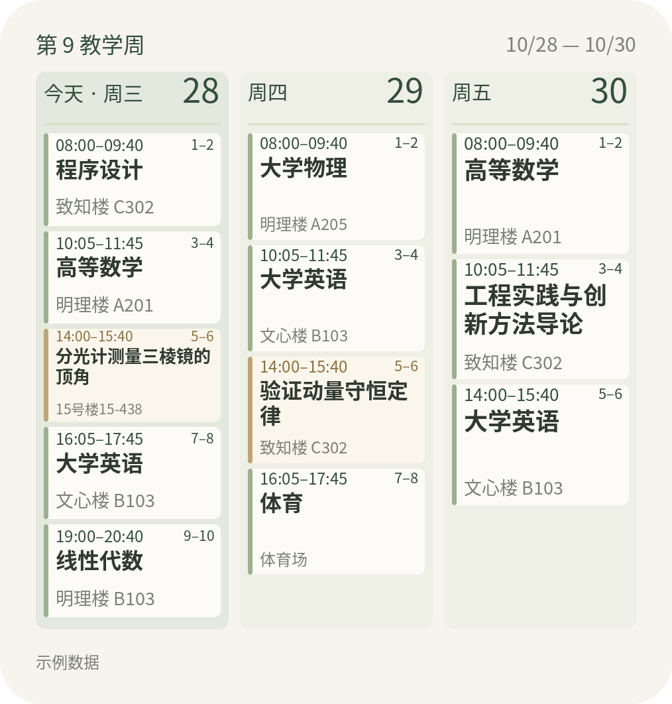
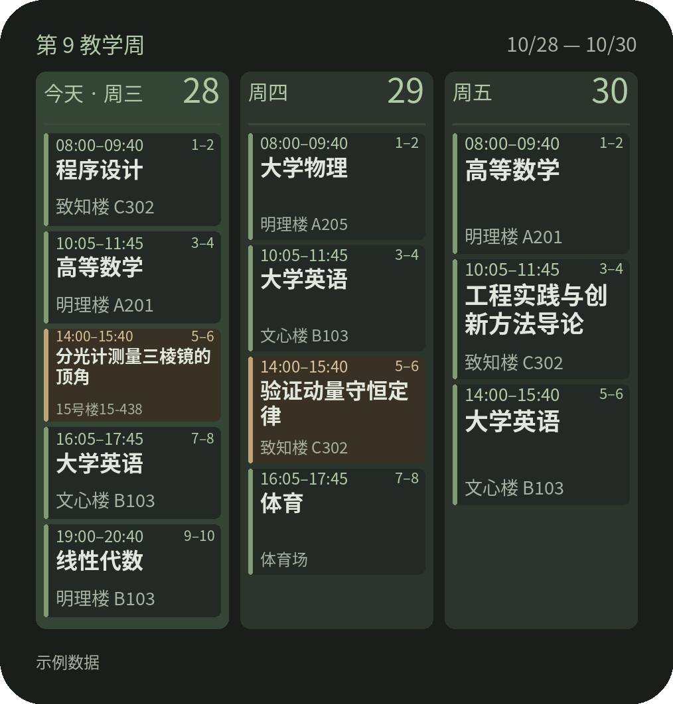

# KOMA 三日课表

适用于 iPhone Scriptable 的大号（4×4）课表组件。

 

*效果示意，均为示例数据。*

## 特征

- 显示今天起连续三天，保留教学周、时间、课名和地点，实验只显示项目名。
- 五到一门课逐档增高，课少时名称可换行；每天最多五门，多余显示数量。
- 自动深浅色、离线缓存；Token 保存在 Keychain。
- 建议每 30 分钟刷新，实际由 iOS 调度。

## 用法

1. 下载 [KOMA.js](https://github.com/liuayueeryuan0313/1/releases/latest/download/KOMA.js)，导入 Scriptable。
2. 在 [KOMA](https://github.com/liuayueeryuan0313/KOMA)「订阅日历 → ICS 订阅 → 小组件 Token」生成专用 Token。服务端需支持 `/api/widget/v1/timetable` 接口。
3. 运行脚本 →「配置接口与 Token」，填 HTTPS 站点地址和 Token；教学周自动读取。
4. 桌面添加 Scriptable 大号组件并选择此脚本，无需组件参数。

更新版本时替换脚本即可，已保存配置会保留。
